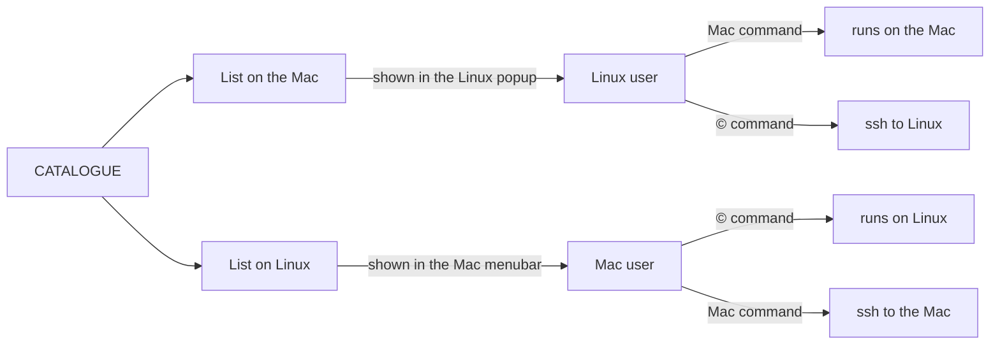

<div align="center">

<p align="center"></p>

<p align="center">
  <a href="https://www.python.org/"><picture><source media="(prefers-color-scheme: dark)" srcset="https://shieldcn.dev/badge/Python%203.svg?variant=outline&amp;theme=blue&amp;logo=python&amp;logoColor=ffffff&amp;mode=dark"></picture></a>
  <a href="https://kdeconnect.kde.org/"><picture><source media="(prefers-color-scheme: dark)" srcset="https://shieldcn.dev/badge/KDE%20Connect.svg?variant=outline&amp;theme=blue&amp;logo=kde&amp;logoColor=ffffff&amp;mode=dark"></picture></a>
  <a href="https://www.apple.com/macos/"><picture><source media="(prefers-color-scheme: dark)" srcset="https://shieldcn.dev/badge/macOS.svg?variant=outline&amp;theme=blue&amp;logo=apple&amp;logoColor=ffffff&amp;mode=dark"></picture></a>
  <a href="https://kde.org/plasma-desktop/"><picture><source media="(prefers-color-scheme: dark)" srcset="https://shieldcn.dev/badge/Plasma%206.svg?variant=outline&amp;theme=blue&amp;logo=kde&amp;logoColor=ffffff&amp;mode=dark"></picture></a>
  <a href="#license"><picture><source media="(prefers-color-scheme: dark)" srcset="https://shieldcn.dev/badge/GPL%20License.svg?variant=outline&amp;theme=blue&amp;logo=ri%3ATbBrandOpenSource&amp;logoColor=ffffff&amp;mode=dark"></picture></a>
</p>
<p align="center"><strong>One grouped list of KDE Connect Run Commands, shown on a Mac and a Linux desktop at the same time.</strong></p>
<p align="center">
  <a href="#quick-start">Quick Start</a> | <a href="#catalogue">Catalogue</a> |
  <a href="#usage">Usage</a> | <a href="#how-it-works">How It Works</a> |
  <a href="#configuration">Configuration</a> | <a href="#troubleshooting">Troubleshooting</a> |
  <a href="#structure">Structure</a> | <a href="#development">Development</a> | <a href="#license">License</a>
</p>
</div>

---

<a name="quick-start"></a>

##  Quick Start

Requires Python 3 on both machines, KDE Connect paired and reachable on the LAN, and passwordless ssh both ways. Nothing is installed: the script has no dependencies.

```bash
git clone https://github.com/deathrashed/kdeconnect-commands.git
cd kdeconnect-commands
python3 kdeconnect_commands.py apply --dry-run   # preview, writes nothing
python3 kdeconnect_commands.py apply             # write both command lists
python3 kdeconnect_commands.py restart           # reload both daemons
python3 kdeconnect_commands.py check             # confirm each side sees the other's list
```

> [!IMPORTANT]
> Edit the ids and ssh aliases at the top of `kdeconnect_commands.py` first. They name one specific pair of machines, and `apply` overwrites each device's existing Run Command list. A backup is kept next to each config.

<a name="catalogue"></a>

##  Catalogue

Names read `Group: Name`, so the popup sorts into groups. Linux commands end in a `©` so you can tell the two machines apart at a glance. A command a machine does not have, such as Hibernate on a Mac, is left out for that side.

| Group | Commands | macOS | Linux |
| --- | --- | :---: | :---: |
|  Power | Lock Screen, Sleep, Log Out, Reboot, Shutdown, Keep Awake 1h, Keep Awake Off | yes | yes |
|  Power | Unlock Screen, Screen Off, Hibernate, Profile Performance, Profile Balanced, Profile Power Saver | no | yes |
|  Volume | Up, Down, Mute Toggle, Set 25%, Set 50%, Set 100% | yes | yes |
|  Volume | Mic Mute Toggle | no | yes |
|  Media | Play Pause, Next, Previous, Stop | Spotify only | yes |
|  Display | Brightness Up, Down, Max, 50%, Min | no | yes |
|  Appearance | Dark Mode, Light Mode | yes | yes |
|  Appearance | Dark Mode Toggle | yes | no |
|  Screenshot | Full Screen, To Clipboard | yes | yes |
|  Sound, Notify, Clipboard | Ping, Alert, Hello, Clear | yes | yes |
|  Apps | Waterfox, Chrome, Obsidian, Feishin, Terminal, Files | yes | yes |
|  Apps | Spotify | yes | no |

`python3 kdeconnect_commands.py show` prints the same table from the script.

<a name="usage"></a>

##  Usage

```bash
python3 kdeconnect_commands.py show             # the catalogue, one line per command
python3 kdeconnect_commands.py apply            # write both configs; --dry-run previews
python3 kdeconnect_commands.py restart          # reload both daemons
python3 kdeconnect_commands.py check            # compare what each daemon reports
```

| Action | Effect |
| --- | --- |
| `show` | Lists every command and which machines have it. |
| `apply` | Builds both lists and writes them. Idempotent: a second run reports `unchanged`. |
| `apply --dry-run` | Prints the entry counts and writes nothing. |
| `restart` | Reloads the cachy daemon and reopens the Mac app so its daemon is a launchd child. |
| `check` | Exits nonzero unless each machine sees exactly the other's catalogue. |

To add or change a command, edit `CATALOGUE` in the script, then run `apply` and `restart`. Do not edit the KDE Connect configs by hand, they are regenerated.

> [!TIP]
> Each command can also run from a shell. Pair `kdeconnect-cli -d DEVICE_ID --list-commands` with `--execute-command ID` to trigger one without the menu.

<a name="how-it-works"></a>

##  How It Works

KDE Connect keeps one Run Command list per paired device, and every command runs on the machine that owns the list. The other machine only shows the list as a menu. So the script writes two lists, each with the local commands plus an `ssh` entry for every command that lives on the other machine.



| Piece | Behavior |
| --- | --- |
| Local command | Runs directly with the daemon's bare environment. |
| Cross-machine command | `ssh -o BatchMode=yes HOST "echo BASE64 \| base64 -d \| sh"`, so quoting survives and fish, the Linux login shell, never parses it. |
| Environment | Each side exports what its tools need: `PATH` for Homebrew on the Mac, the D-Bus and Wayland variables on Linux. |
| Entry ids | A hash of the side and name, so ids are stable and a re-run changes nothing. |
| Writes | The installer runs under `python3 -` on each machine, backs up the config first, then replaces only the `commands=` line. |

<details>
<summary> <strong>Config Locations</strong></summary>

| Machine | Path |
| --- | --- |
| macOS | `~/Library/Preferences/kdeconnect/<linux device id>/kdeconnect_runcommand/config` |
| Linux | `~/.config/kdeconnect/<mac device id>/kdeconnect_runcommand/config` |

The folder name is the id of the *other* device. The value is a JSON object inside `commands="@ByteArray(...)"`, with each key an entry id and `name` and `command` inside.

</details>

<a name="configuration"></a>

##  Configuration

Everything is a constant at the top of `kdeconnect_commands.py`.

| Constant | Purpose |
| --- | --- |
| `MAC_HOST`, `CACHY_HOST` | ssh aliases for the two machines. |
| `MAC_ID`, `CACHY_ID` | KDE Connect device ids, found as folder names under each machine's `kdeconnect` config folder. |
| `MARK` | The suffix on Linux command names, a copyright sign by default. |
| `CACHY_ENV`, `MAC_ENV` | Environment exported before a command that runs over ssh. |
| `CATALOGUE` | The commands: `(group, name, mac command or None, linux command or None)`. |

<a name="troubleshooting"></a>

##  Troubleshooting

<details>
<summary> <strong>Empty List</strong></summary>

Reload both daemons with `restart`, then run `check`. A running daemon keeps its list in memory, so a config edit does nothing until it restarts.

</details>

<details>
<summary> <strong>Cross-Machine Command Does Nothing</strong></summary>

Test the ssh hop from the machine that runs it: `ssh -o BatchMode=yes HOST true`. It must succeed with no password prompt. Under a sandbox, add `-o ControlPath=none` if multiplexing sockets are not allowed.

</details>

<details>
<summary> <strong>Device Not Reachable</strong></summary>

KDE Connect uses ports 1714 to 1764 over TCP and UDP. Open them in the firewall on both machines, and make sure the network does not block UDP broadcast. See the [KDE Connect troubleshooting guide](https://userbase.kde.org/KDEConnect#Troubleshooting).

</details>

<details>
<summary> <strong>Mac Permission Prompt</strong></summary>

Log Out, Reboot, Shutdown and the dark-mode commands use System Events. macOS asks for Automation permission the first time each one runs.

</details>

<details>
<summary> <strong>Media Keys on the Mac</strong></summary>

macOS has no command line for media keys, so Media entries on the Mac only control Spotify while it is running.

</details>

<a name="structure"></a>

##  Structure

```text
kdeconnect-commands/
├── kdeconnect_commands.py   # catalogue, builder, installer, restart, check
├── README.md
├── LICENSE
└── .gitignore
```

<a name="development"></a>

##  Development

```bash
python3 -m py_compile kdeconnect_commands.py   # syntax check
python3 kdeconnect_commands.py apply --dry-run # builds both lists, writes nothing
python3 kdeconnect_commands.py check           # needs both machines online
```

The script uses only the standard library. Cross-machine commands depend on the ssh aliases above, so the `check` step is the real end-to-end test.

<a name="license"></a>

## <a href="https://www.gnu.org/licenses/gpl-3.0.html"></a> License

<div align="center">

[**𝗚𝗡𝗨 𝗚𝗣𝗟 𝗟𝗜𝗖𝗘𝗡𝗦𝗘**](https://raw.githubusercontent.com/deathrashed/gupload/refs/heads/main/uploads/files/licenses/gpl/LICENSE)

<a href="https://raw.githubusercontent.com/deathrashed/gupload/refs/heads/main/uploads/files/licenses/gpl/LICENSE"></a>

**𝗖𝗢𝗣𝗬𝗥𝗜𝗚𝗛𝗧 © 𝟮𝟬𝟮𝟲 𝗗𝗘𝗔𝗧𝗛𝗥𝗔𝗦𝗛𝗘𝗗**

</div>
